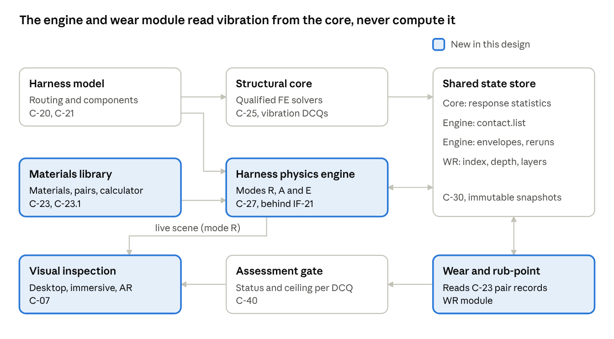
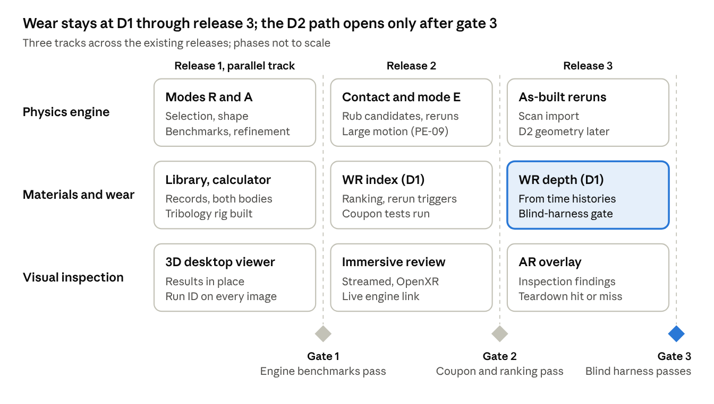

# Wire Harness Vibration Simulator: Design Specification

Oct 28, 2026 · @Keith Willett

## 1. Document control

This is design draft 0.3. It adds five components to the Wire Harness Vibration Simulator: a harness physics engine, a materials and tribology library, a property calculator, a wear and rub-point module, and 3D and augmented reality (AR) visual inspection. It builds on Requirements Specification 0.3 (October 11, 2026) and Architecture Specification 0.2 (October 14, 2026), and is limited to public information until TE Connectivity confirms it. Draft 0.3 is written to be build-ready: its companion [Build Plan 0.1](build-plan-0.1.md) holds the state descriptors, benchmark definitions and work packages.

| Field | Value |
| --- | --- |
| Version | 0.3 (build-ready draft) |
| Basis | Requirements Specification 0.3; Architecture Specification 0.2; public game-physics, harness-simulation and tribology literature (section 14); an independent Codex review of draft 0.2 |
| Companion | [Build Plan 0.1](build-plan-0.1.md): state descriptors, benchmark and acceptance definitions, work packages |
| Audience | TE Transportation Solutions engineering, simulation, test, materials and digital engineering leads, and the engineers and agents who build from it |
| Approval | Pending TE review |
| Changes to companion documents | Six amendments, A1 to A6, in the register in section 3.2 |

The keywords SHALL, SHOULD and MAY follow RFC 2119. New IDs use these prefixes so they trace beside the existing ones:

| Prefix | Meaning |
| --- | --- |
| PE-xx | Physics engine requirement |
| MAT-xx | Materials and tribology library requirement |
| WR-xx | Wear and rub-point requirement |
| VIS-xx | 3D and AR visual inspection requirement |
| C-xx, IF-xx, AD-xx | Component, interface and architecture decision, continuing the Architecture 0.2 numbering |
| A1 to A6 | Amendment to a companion document (section 3.2) |
| WP-xx, B-xx | Work package and benchmark case in the Build Plan |

In this document "TE" alone means TE Connectivity.

## 2. Short answer: how hard is a harness physics engine?

A purpose-built harness physics engine is feasible from published game-physics and automotive cable-simulation work, and the hard part is data, not code. The rod and contact methods that games and film use for hair, rope and cables (Cosserat rods solved with extended position-based dynamics, XPBD) are well documented, and Fraunhofer and Fraunhofer-Chalmers have shown the same rod theory running in real time for automotive cables in IPS Cable Simulation. What the literature does not hand over is the stiffness, damping and wear data that make the numbers trustworthy. Stiffness can mostly be calculated from material data and bundle geometry, and damping in part, so TE labs measure materials and a few bundles per construction family rather than every design (section 6.5). Wear coefficients still have to be measured.

The engine should not replace the qualified finite element (FE) solvers for decision-critical quantities (DCQs). Real-time rod solvers trade accuracy for speed in ways that need checking case by case. Classic position-based dynamics (PBD) ties effective stiffness to iteration count and time step. Extended PBD (XPBD) removes that dependence when each step's constraints converge, but a real-time budget often stops short of convergence, and both add numerical damping. That is acceptable for installed shape, clearance and rub-point screening once benchmarks measure the error. It is not acceptable for a 2,000 Hz random-vibration margin. The design therefore splits the work: the engine owns geometry, large motion, contact detection and wear kinematics; the qualified solvers keep the vibration DCQs.

| Capability | Difficulty | What public work supplies | What TE must supply | Recommendation |
| --- | --- | --- | --- | --- |
| Installed shape, routing, clip snap-in, clearance (quasi-static) | Moderate | Cosserat rod theory, XPBD and direct rod solvers, open GPU libraries, commercial harness tools | Material data and a few bundle tests per construction family; bundle stiffness is then calculated (section 6.5) | Build or buy, decided by the AD-09 selection (section 5.6) |
| Rub-point detection under vibration envelopes | Moderate | Collision detection (bounding volume hierarchies, continuous collision), mode-shape envelopes from the core | Clearance limits, covering thickness, edge radius per feature | Build; screening only |
| Large-motion dynamics (articulation, cab, boom, door hinge) | Moderate to hard | Rod dynamics with damping, rigid-body coupling | Measured damping, motion profiles | With the engine; D1 ceiling |
| Vibration response to 2,000 to 3,000 Hz with frictional clips | Hard | FE theory, but no validated game solver | Everything in Requirements section 14.1 | Do not build; keep qualified solvers (AD-01) |
| Friction wear and layer breach on both bodies | Moderate physics, hard data | Archard and dissipated-energy wear laws, scrape and cross-wire abrasion test methods | Wear coefficients per material pair for both bodies, by temperature and contaminant | Build; D1 ranking through release 3, D2 path after (section 7.5) |
| 3D and AR visual inspection | Moderate | OpenUSD and glTF pipelines, OpenXR, vendor enterprise SDKs | Device and hosting approval, CAD access, releasable tracking models | Immersive review first; AR overlay second, as an inspection aid |

The answer to "can it be built from what is documented online" is yes for the methods and a working prototype, and no for credibility. Credibility comes from the pilot gates in Requirements section 14, extended here with engine, computed-property and wear gates (section 11 and Build Plan section 5). Wear results stay at D1, ranking and screening, through release 3; section 7.5 fixes the route to D2 before any wear data arrives.

## 3. Purpose, scope and changes to the companion documents

This specification adds five components to the platform and amends six statements in the companion documents to make room for them. Everything else in Requirements 0.3 and Architecture 0.2 stands, including the decision classes, the shared state model, the assessment gate and the data classification rules.

### 3.1 What this design adds

- **Harness physics engine (C-27).** A Cosserat rod engine, built or bought under AD-09, for installed shape, large motion, clearance and contact, with a real-time mode for interactive and immersive use, an accurate mode for assessments, and an envelope mode for contact screening.
- **Materials and tribology library (C-23) and property calculator (C-23.1).** Versioned material records, tribology pair records for both bodies at each contact, counterface layer stacks, and bundle properties calculated from their constituents with stated bounds.
- **Wear and rub-point module (WR, C-26.6).** A sixth analysis module that finds where a harness can touch its surroundings or itself, ranks contacts by a relative wear index and, from core time histories, predicts wear depth and layer breach on both the harness and the surface it rubs against.
- **Visual inspection service (C-07).** Desktop and immersive review of the installed harness, its mode shapes, clearance and wear hotspots at full scale before anything is built, and an AR overlay on physical builds as an inspection aid.

### 3.2 Amendment register

This register is the one place that lists every change this design asks of the companion documents.

| ID | Document and clause | Current text (summary) | Proposed change | Effective | Reason |
| --- | --- | --- | --- | --- | --- |
| A1 | Requirements 0.3, section 2.3 | Writing a new finite element or field solver is out of scope | A new FE or field solver stays out of scope. A rod geometry and contact engine, built or bought, is in scope with its own credibility record | Release 1 | The engine answers questions the FE solvers answer slowly and does not compete for vibration DCQs |
| A2 | Architecture 0.2, AD-01 | Orchestrate qualified solvers behind adapters; a custom FE solver rejected | AD-01 holds for every vibration DCQ. AD-09 selects the engine source and AD-15 places it behind a new adapter class (section 10.3) | Release 1 | Keeps solver independence and the benchmark rule |
| A3 | Requirements 0.3, section 6.2 | Five analysis modules | Six modules: add wear and rub-point (WR) | Release 2 | Layer breach by rubbing is a failure mode the five modules do not cover |
| A4 | Architecture 0.2, principle P5 | "Orchestrate solvers, do not write them" | Unchanged for vibration solving. The platform may own in-house kinematics and wear post-processing (engine mode E, the contact sweep and WR) that read solver results and never produce vibration response | Release 1 | Mode E and WR need contact data no adapter exposes; they compute no vibration |
| A5 | Architecture 0.2, section 10.1 | Rod and cable specialist class: static, modal, harmonic, PSD and transient operations | Add a capability-limited "rod geometry and contact" class: static shape, large motion, contact query and envelope kinematics, with modal, harmonic, PSD and vibration-transient operations declared unsupported (section 5.7) | Release 1 | The existing class would make the engine a second source of vibration numbers |
| A6 | Requirements 0.3, section 14.1 pilot step 3, and VAL-02 | Every DCQ input has a measured value and uncertainty; calibration uses measured stiffness and damping | Release 1 unchanged. From release 2, a calibrated bundle stiffness or damping value (MAT-09) satisfies the gate for its construction family once the section 11.4 checks pass and TE approves the evidence (Build Plan WP-09) | Release 2, on TE approval | Measures materials once and a few bundles per family instead of every design, without weakening release 1 |

### 3.3 Out of scope

- Using any engine mode as the source of a vibration DCQ (displacement, stress, fatigue, micromotion). Those stay with the qualified solvers (AD-10).
- WR results above D1 in releases 1 to 3. The D2 path is specified now (section 7.5) and gated after release 3.
- Any guarantee of no rub-through, and any field life in years.
- Corrosion prediction. WR stops at "substrate exposed" and raises a corrosion risk flag for the owning team (AD-17).
- Terminal-level fretting wear, which remains the contact-physics module (CP-01 to CP-04).
- Tracking a harness that is free to move. AR anchors to rigid parts; the harness is compared, not tracked (section 8).
- Dimensional acceptance by AR or scan, except where VIS-11 allows it.
- Staffing and schedule estimates. Release order and gates set the sequence (section 12).

## 4. Prior art: what gaming and automotive work already gives us

Two bodies of public work meet in a harness engine. Games and film solved stable, fast, collision-rich rods; automotive digital mock-up solved rods with measured, physically meaningful parameters. Neither alone is enough, and the design takes the solver tricks from the first and the parameter discipline from the second.

| Work | Field | What it shows | What this design reuses | Limit to respect |
| --- | --- | --- | --- | --- |
| [Position and Orientation Based Cosserat Rods](https://www.vci.rwth-aachen.de/publication/0550/) (Kugelstadt and Schömer, 2016) | Game and animation physics | Bending and torsion of rods inside position-based dynamics, using quaternions per segment; over an order of magnitude faster than earlier position-based rods | Real-time mode formulation (section 5.2) | Effective stiffness depends on iteration count and time step unless each step converges; measure the error by benchmark before use |
| [Direct Position-Based Solver for Stiff Rods](https://diglib.eg.org/items/7e668ddc-ff48-4ad4-bdf6-167cc4a338ed/full) (Deul, Kugelstadt, Weiler, Bender) | Game and animation physics | Direct XPBD solve for stiff rods with Cosserat bending and twist constraints; about two orders of magnitude faster than iterative XPBD | Solver for stiff HV cable and taped bundles | Converges the constraints each step, but integration error and numerical damping remain; benchmark before use |
| [Stable Cosserat Rods](https://graphics.cs.utah.edu/research/projects/stable-cosserat-rods/Stable_Cosserat_Rods-SIGGRAPH25.pdf) (SIGGRAPH 2025) | Graphics research | Newer stable rod formulation, compared against XPBD | Candidate upgrade path for the real-time mode | Research code; evaluate before adopting |
| [Discrete Elastic Rods](https://www.cs.columbia.edu/cg/rods/) (Bergou et al., 2008) | Film and graphics | Discrete geometric rod model checked against buckling and stability experiments and analytic solutions | Accurate-mode discretization and benchmark cases (Build Plan section 5.1) | Quasi-static material frame; damping must be added |
| [IPS Cable Simulation](https://www.fcc.chalmers.se/software/ips/ips-cable-simulation) (Fraunhofer-Chalmers Centre) | Automotive digital mock-up | Real-time Cosserat rod deformation of cables, hoses and wires; clips, forces, cable length, motion | Parameter set (stretch, bend, torsion stiffness, line density) and clip modeling approach | Commercial product; a candidate in the AD-09 selection (section 5.6) |
| [Fraunhofer ITWM rod modeling](https://wias-berlin.de:8443/workshops/MaDiFa/docs/Linn.pdf) and [damped Cosserat parameter study](https://repozitorium.omikk.bme.hu/items/4da98b6b-271d-4502-9ae7-760979cb22b7/full) | Automotive cable research | Geometrically nonlinear Cosserat beams; Kelvin-Voigt damping identified from torsion and bending oscillation tests | Damping model and test method for parameter identification | Effective parameters vary with taping, temperature and amplitude |
| [Cable dynamics and fatigue for digital mock-up](https://research.chalmers.se/en/publication/251630) (Chalmers, 2017) | Automotive digital mock-up | Dynamic cable simulation followed by comparative load-data analysis to rank configurations for damage | Ranking use (D1) of dynamic rod results | Comparative, not absolute, life |
| [IC.IDO](https://www.esi-group.com/blog/accelerating-automotive-design-and-manufacturing-with-virtual-reality) (ESI, now Keysight) and the [MIT thesis on its use at Nissan](https://dspace.mit.edu/handle/1721.1/139461) | Automotive VR assembly validation | Real-time cables and hoses in immersive assembly review; the thesis found it weak for long harnesses and flexible parts | Lesson: immersive review needs a rod engine built for harness scale, not a general one | Vendor claims largely unverified |
| [Erez, Tassa and Todorov, ICRA 2015](https://homes.cs.washington.edu/~todorov/papers/ErezICRA15.pdf) | Robotics simulation | Bullet, Havok, MuJoCo, ODE and PhysX each did best on the systems they were built for | Do not pick a general game engine and hope; build or buy for rods | Written by MuJoCo's developers |
| [Newton](https://www.linuxfoundation.org/press/linux-foundation-announces-contribution-of-newton-by-disney-research-google-deepmind-and-nvidia-to-accelerate-open-robot-learning) (Linux Foundation, 2025) | Open GPU physics | Apache 2.0 engine on NVIDIA Warp with XPBD, VBD and MuJoCo solvers | Candidate GPU kernel base for the real-time mode | Rod support unconfirmed; APIs still change often |

The lesson from the robotics comparisons and the IC.IDO thesis is the same. General engines do well on what they were built for, and long, stiff, taped harnesses are not what game engines were built for. The engine is therefore a rod engine first, with game techniques used inside it, not a game engine with cables added.

## 5. Harness physics engine (C-27)

The engine is a Cosserat rod engine with three modes on one model: real-time (R) for interactive and immersive work, accurate (A) for anything that enters an assessment, and envelope (E) for contact screening against core vibration results. It owns geometry, large motion and contact. It reads vibration response from the structural core and never computes it (AD-10), so the qualified solvers stay the only source of vibration DCQs.

Whether TE builds the engine or buys modes R and A is decided by the AD-09 selection (section 5.6), so this section states what any engine must do. Mode E, the contact sweep and WR are in-house either way, because they need contact-state access that a commercial tool may not expose (amendment A4).

### 5.1 Responsibilities and boundaries

| The engine does | The engine does not |
| --- | --- |
| Solve installed shape under gravity, slack, clip snap-in and assembly tension, as a fast seed for core stage 3 (PHY-01) and as the D1 shape for routing variants | Replace core stage 3 for D2 and above |
| Sweep routing and clip variants interactively and in batch (SYS-01, DET-04) | Compute modal, harmonic, PSD, shock or any other vibration response |
| Detect contacts between harness and environment, harness and harness, and harness and itself, with minimum surface clearance | Predict terminal micromotion or fretting (core stage 7 and CP module) |
| Run large-motion cases (door and tailgate hinges, decoupled cab, boom and implement articulation) and hand the rigid-body motion track to the core (APP-04) | Run explicit crash dynamics (CR module) |
| Map core vibration results onto contacts as motion envelopes for WR screening, and request core reruns where new contacts matter | Produce wear depth or life; WR does that from core time histories |
| Drive the 3D and immersive scene at headset frame rates (section 8) | Hold its own copy of component or material data |

### 5.2 Model

Each bundle segment between nodes in the harness topology (connectors, splices, clips, branch points) is a rod. Any engine, built or bought, must declare its rod formulation (PE-14):

- **Kinematics.** Unshearable (Kirchhoff) rods are allowed where segment slenderness, length over outer diameter, is at least 10 and benchmark B-11 confirms the error for that construction. Shorter segments use a shearable Cosserat formulation with two shear stiffnesses from C-23.1.
- **Inertia.** Translational and rotary inertia in dynamic mode; quasi-static mode has none.
- **Rest shape.** Rest curvature and rest twist come from the bundle's natural shape, measured or justified and recorded with its basis, never from the installed routing. A bundle laid straight and taped has zero rest curvature; one formed on a board keeps a measured set. Installed geometry is stored separately, so the bending preload that drives springback is kept.
- **Constitutive law.** Axial, two bending and one torsion stiffness, uncoupled unless the property record supplies a coupling term. Stiffness may depend on temperature and, for bundles with wire stick-slip, on curvature (section 6.5).
- **Shared discretization.** Modes R and A use the same nodes, segments and parameter set; mode A may refine segments for the PE-12 checks.
- **Junctions.** Branch points and splices are compliant junctions with a stated rotational stiffness, rigid only by logged choice, because a taped breakout may not carry full moment.

| Element | Representation | Data source |
| --- | --- | --- |
| Bundle segment | Rod: axial, two bending, one torsion and, for shearable segments, two shear stiffnesses; rest curvature and twist with their basis; line density; Kelvin-Voigt damping in dynamic mode; contact radius | C-20 and C-23 records and C-23.1 calculated properties (section 6.5); for release 1 core use, measured per Requirements pilot step 3 |
| Covering (tape, conduit, braided sleeve, foam) | Adds stiffness and mass to the segment, sets the outer contact radius and the outer material ID that wear reads | C-23, with taping pattern and overlap |
| HV cable | Layered rod (conductor, insulation, shield, jacket) collapsed to effective properties per INP-02d | C-20, C-23.1 |
| Branch point and splice | Compliant junction with position continuity and a stated rotational stiffness | C-21 harness model, C-23.1 |
| Connector and housing | Rigid body with mass, inertia and a collision hull | C-20, 108 and 114 references (INP-09) |
| Clip, clamp, grommet | Constraint with stiffness, damping, friction, clearance and allowed slide or rotation (INP-05a); rigid only by logged choice (INP-05b) | C-20 |
| Environment | Tessellated CAD of brackets, panels, fasteners and neighbors, with an edge radius and a counterface layer-stack ID per feature | IF-30 CAD and PLM; C-23 counterface records |

Edge radius is carried on the environment, not inferred from the mesh. Wear depends heavily on whether a harness slides over a flat panel or a sheared sheet-metal edge, and tessellation hides that difference.

### 5.3 Solver modes

| Mode | Method | Permitted outputs | Determinism | Ceiling |
| --- | --- | --- | --- | --- |
| R, real-time | XPBD rod constraints or a direct position-based rod solver on GPU, fixed sub-steps per frame | Scene state for viewing and drag-to-edit; rub-candidate hints labeled "visual only" | Not released | None; never enters an assessment |
| A, accurate quasi-static | Implicit energy minimization (Newton with line search) on the shared discretization, double precision, converged to a stated residual and checked by refinement (PE-12) | Installed shape, clearance, clip loads; seed for core stage 3 | CPU reference path for released runs (DET-01) | D1 after benchmarks; D2 for geometry only through section 7.5 |
| A, accurate dynamic | Implicit time integration with Kelvin-Voigt damping and regularized Coulomb friction, for motion below the first harness mode | Rigid-body motion track for articulated interfaces, handed to the core to superimpose vibration (APP-04); contacts during large motion | Same as above | D1 |
| E, envelope | Not a solver: maps core response (mode shapes with response statistics, or stored time histories) onto the mode A shape by arc length | Contact candidates, motion envelopes, slip state and force estimates for screening; contact rerun requests; never depth or life | Inherits the core run manifest | Screening inputs only; WR results built on them are capped at D1 |

Modes R and A share one model file and one parameter set. A result seen in the headset can always be rerun in mode A. Mode R never enters an assessment; mode A results enter under their own ceiling; mode E outputs enter only through WR, under WR's ceiling (PE-03). Damping in dynamic mode is Kelvin-Voigt only, with any numerical dissipation reported separately (PE-16); vibration damping stays a core input.

### 5.4 Contact and friction

- **Broad phase.** A bounding volume hierarchy over swept capsules per rod segment and over environment triangles, rebuilt per step in mode R and per envelope sample in mode E.
- **Narrow phase.** Capsule to capsule for harness pairs and capsule to triangle for environment, with continuous collision in mode R and in dynamic mode A, so fast motion cannot tunnel through thin panels inside the validated domain (Build Plan section 5.3).
- **Candidate generation.** A site is a candidate wherever its static gap is smaller than the expected relative excursion plus its uncertainty: a conservative excursion bound computed for every segment from the core response statistics before any pruning, then refined per candidate from the envelope (PE-13). Clearance is reported as minimum surface clearance, not node distance.
- **Friction.** Regularized Coulomb with a tangential contact stiffness k\_t per pair class. The coefficient comes from C-23 for the pair at the case temperature; a missing pair blocks D2 use (INP-07b) and blocks depth.
- **Slip state.** A screening estimate only. The quantity compared is the peak relative tangential displacement of the two surfaces at the site; the stick limit is μ times the minimum normal force while the contact is closed, divided by k\_t. A site whose contact opens during the cycle is reported as intermittent and treated as indeterminate for screening. At or below the limit the site is stuck; at 3 times the limit or more (proposed) it is in gross slip; in between it is indeterminate, reported and not modeled (WR-01). Depth never uses this estimate; it uses the sliding history from the core.
- **Contact classes.** Harness to environment, harness to harness, harness to itself, harness to clip, because wear laws and limits differ by class.
- **New contacts.** A discovered site above the trigger thresholds writes a rerun request, and the core reruns with that contact modeled before WR computes any depth (PE-15, AD-18).

### 5.5 Performance targets (proposed)

| Case | Target | Main lever |
| --- | --- | --- |
| Mode R, 20-branch passenger-car harness with vehicle environment | 90 frames per second on the approved headset or workstation | GPU constraints, level of detail on environment |
| Mode A installed shape, 40-branch, 15 m truck harness | Under 5 minutes | Sparse direct solver, warm start from mode R |
| Mode E contact sweep on one core random-vibration result | Under 15 minutes | Envelope sampling, cached bounding volume hierarchy |
| 100 routing variants, mode A plus mode E | Engine and WR work overnight; the PRF-02 total, core runs included, governs the study | Parallel variants; content-hash reuse of core results only where core inputs hash the same (Architecture 6.2), such as load-case variants on one routing |

A routing change changes equilibrium and mode shapes, so each routing variant needs its own core response; the cache cannot skip that. These are runtime targets to agree with TE once the benchmark assemblies are chosen, not schedule estimates.

### 5.6 Engine selection (AD-09)

AD-09 is a pending selection, not a build decision. Build Plan WP-04 scores each candidate against the criteria below, using the benchmark suite (Build Plan section 5.1) as the common test, and the TE owner signs the result. Candidates include IPS Cable Simulation, any harness tool TE already licenses, an open GPU base such as Newton, and an in-house prototype.

| Criterion | What is checked | Weight (proposed) |
| --- | --- | --- |
| Benchmark accuracy | B-01 to B-08 pass through a thin harness | Must pass |
| Determinism | Repeats within DET-01 on a CPU reference path and declares its behavior | Must pass |
| Contact-state access | Contact points, forces, slip and clearance available per step through an API | 3 |
| Batch and headless operation | Runs scripted, without a display, many runs in parallel | 3 |
| Model exchange | Imports the C-21 harness model and C-23 properties without manual steps | 2 |
| Licensing | Allows batch, compute-zone and XR use inside TE | 2 |
| Real-time performance | Meets the section 5.5 mode R target | 2 |
| Cost and support | License and support terms | 1 |

### 5.7 Rod geometry and contact adapter class (IF-21)

The engine registers under a new, capability-limited adapter class (amendment A5, AD-15). It carries the same duties as any adapter: benchmark pass before registration and after every change, a determinism declaration and full run manifests (PE-10, PE-11).

| Operation | Status | Consumers |
| --- | --- | --- |
| Static installed shape | Supported | Core stage 3 seed, WR, viewer |
| Large-motion transient below the first harness mode | Supported | Core model assembly (APP-04) |
| Contact query: sites, class, minimum clearance | Supported | WR, viewer |
| Envelope kinematics (mode E) | Supported, in-house | WR |
| Modal, harmonic, PSD and vibration-transient analysis | Unsupported; returns a typed error | None |

## 6. Materials and tribology library (C-23)

The library holds every material a harness is made of or rubs against and, more important, every material pair with its friction and wear behavior for both bodies. Public sources give abrasion ratings (strokes to failure in a standard test), not wear coefficients. So the library starts from public ratings, which support ranking and the relative wear index only, and fills in coefficients from a TE test program before WR reports any depth.

### 6.1 Material classes

| Class | Typical materials | Properties held |
| --- | --- | --- |
| Conductors | Bare and tinned copper, copper alloys for thin data lines, aluminum for HV | Modulus, density, yield, fatigue curve, temperature dependence |
| Wire insulation | PVC, PP, PE and cross-linked polyolefin, TPE, ETFE and cross-linked ETFE, silicone for HV | Modulus against temperature, hardness, thickness class, ISO 6722-1 temperature class and scrape-abrasion result, friction and wear pairs |
| Coverings | PET fleece, woven and velour tapes, PVC tape, corrugated conduit (PA6, PA12, PP), braided PET sleeve, foam | LV 312 abrasion class, thickness, stiffness and mass added to the bundle, friction and wear pairs |
| Clips and mounting | Glass-filled PA66, POM, EPDM and TPE grommets | Stiffness and damping against temperature, friction pairs |
| Counterfaces (surfaces the harness touches) | Painted and e-coated steel, galvanized steel, cast aluminum, magnesium, PP and PA trim, fastener threads | Layer stack (topcoat, primer or e-coat, zinc, substrate) with thickness and hardness per layer; roughness; edge radius class; friction and wear pairs |
| Third bodies | Dry, humid, oil, coolant, road dust and sand | Multipliers or separate coefficient sets per pair |

### 6.2 Material record

Every record follows INP-07a (units, provenance, revision, uncertainty) and DET-06 (sample count behind every curve).

| Field | Meaning |
| --- | --- |
| ID and revision | Library identifier, grade, supplier and datasheet reference |
| Property set | Each property with units, temperature range, and frequency or rate dependence where declared (INP-03) |
| Uncertainty | Bounds or distribution per property, or "not characterized" |
| Provenance | Test ID, method and edition, lab, date, specimen count |
| Validity | Temperature, frequency and humidity range the data covers |
| Classification | Section 15 tag of Architecture 0.2; supplier data under NDA carries its own tag |

### 6.3 Tribology pair record

Wear is a property of a pair in an environment, not of one material. The pair record is the core of the library.

| Field | Meaning | Example |
| --- | --- | --- |
| Pair | Material A and material B; both bodies wear, each with its own coefficients | PET fleece tape on a painted steel edge; tape and topcoat both wear |
| Contact class | Harness to environment, harness to harness, harness to itself, harness to clip | Harness to environment |
| Friction | Static and kinetic coefficients against temperature | Per measured table |
| Wear law | Archard or dissipated-energy, selected per pair by held-out fit (section 7.2, AD-13) | Energy |
| Coefficients | Coefficients of the selected law for each body, temperature dependent, with uncertainty | From TE reciprocating test |
| Validity range | Contact pressure, sliding amplitude, frequency, temperature, third body, edge radius class | 0.1 to 2 mm amplitude, 20 to 200 Hz, minus 55 to plus 125 degrees C |
| Rating link | Standard abrasion result used as a ranking proxy when coefficients are missing | LV 312 class, ISO 6722-1 scrape strokes |
| Evidence | Test IDs, specimen count, calibration or validation role (never both, as Architecture 6.3 requires) | 5 specimens per condition |

The example values above show the shape of a record. They are placeholders until the test program sets them.

### 6.4 Where the data comes from

| Source | Gives | Use |
| --- | --- | --- |
| Supplier datasheets | Modulus, density, temperature class, abrasion class | Initial records, flagged "rating only" for wear |
| [LV 312](https://patents.google.com/patent/US9611408B2/en) tape abrasion classes (A below 100 strokes, B 100 to 499, C 500 to 999, D 1,000 to 4,999, E 5,000 to 14,999, F 15,000 or more, on a 5 mm mandrel, per Table 1 of the cited patent) | Ordinal ranking of coverings | D1 ranking proxy; edition to be confirmed from the licensed text |
| ISO 6722-1 scrape abrasion and the aerospace [cross-wire and scrape abrasion tests](https://lectromec.com/test/scrape-abrasion-2/) | Strokes or cycles to conductor exposure | Ranking proxy and validation cases for the wear model |
| Literature (Archard and [friction-energy wear](https://hal-bioemco.ccsd.cnrs.fr/ENTPE/hal-04100254v1) work) | Wear laws and typical coefficient ranges, mostly metals and coatings | Model form only; polymer harness pairs need TE data |
| TE tribology test program (new) | Friction and wear coefficients for both bodies of each pair under reciprocating sliding, across temperature and third body, fitted to both wear laws | Calibration and held-out validation for WR-04 and MAT-13; the data behind depth ranges and, later, the D2 path |
| TE field returns and teardown | Rub-through locations and depths | Validation and CRD-06 feedback |

The abrasion classes in published patents differ by edition, and Lectromec notes that standard abrasion tests give no direct basis for in-service life. That is why the library treats ratings as a ranking proxy and asks for coefficients before life predictions.

### 6.5 Computed properties: calculate first, test to confirm

Most of a bundle's mechanical behavior can be calculated from its materials and its construction. Requirements 0.3 already allows this: INP-02b accepts stiffness traceable to "a test or a documented derivation." This section defines that derivation. It changes what the labs measure: each compound, covering and contact pair once, plus a few bundles per construction family to calibrate and check the math, instead of every bundle design. In release 1 calculated values feed the engine only; the core keeps measured inputs under pilot step 3 until amendment A6 takes effect in release 2.

Measure materials once. Calculate every bundle.

| Property | What can be calculated | What still has to be measured | Method | Confirming test |
| --- | --- | --- | --- | --- |
| Axial stiffness | Nearly all of it: conductor and insulation stiffness summed, corrected for strand lay angle | Conductor and insulation moduli (datasheet or tensile test) | Rule of mixtures with a helical strand correction (wire rope theory) | One tensile test per construction family |
| Bending and torsion stiffness | Model bounds: wires bonded into one solid section, and wires sliding freely, each under stated geometry, lay angle, covering preload and end conditions. The bonded bound sums each wire's own second moment and its parallel-axis term about the bundle's neutral axis, weighted by modulus, with nothing in the voids; the free-slip bound sums the wires' own second moments. For n equal wires filling a round bundle uniformly at area packing fraction φ, the ratio is about 1 + n/φ, roughly 50 times for 40 wires at φ = 0.8. Real bundles with mixed gauges and insulated wires differ, and torsion needs its own section analysis. Where the bundle sits between the bounds follows from wire friction and covering pressure, and can change with curvature | Wire-to-wire friction, the effect of tape tension and wrap pitch, insulation modulus across temperature | Bound calculation; a stick-slip strand model giving stiffness against curvature (Papailiou's approach for power-line conductors, whose transfer to insulated, taped bundles is unproven and is checked by section 11.4); a 3D FE micro-model for new constructions | Bend and twist tests on 3 to 5 bundles per construction family at 3 temperatures |
| Polymer damping | Energy loss in insulation, jacket and covering materials across temperature and frequency | Storage and loss modulus of each compound by dynamic mechanical analysis (DMA) | Viscoelastic layer model | Part of the bundle shaker test |
| Friction damping inside the bundle | The trend with amplitude from the stick-slip model: energy lost per cycle grows as more wires slip, while the equivalent loss factor may rise and then fall | The level, which depends on assembly details the model cannot see | Stick-slip model, calibrated | Bundle shaker or bending-cycle test at 2 or 3 amplitudes |
| Clip and grommet stiffness | Elastic stiffness from clip geometry and material modulus | Clearance, friction and preload in the fitted clip | FE model of the clip | Clip pull and push test per clip family |
| Contact pressure at a rub point | Pressure from contact force, edge radius and the layered compliance of covering and coating; capsule geometry alone does not give pressure | Covering and coating moduli and thicknesses (held in the records); a coupon check of the contact model | Layered contact mechanics on the edge radius | Coupon step of the wear validation (Build Plan section 5.5) |
| Wear coefficient | Nothing usable for engineering decisions yet. Calculating it from surface physics is an active research topic, and for polymers the coefficient can drift over the life of the contact | Every pair, both bodies, under reciprocating sliding (section 6.4) | Measured only; literature supplies the model form | TE tribology test program |

**How a computed value is recorded.** Every property in the library declares its basis:

- **Measured:** from a test on the item itself.
- **Computed:** from the property calculator (C-23.1), with the method and its version, the input record IDs, and both bounds where the method gives them.
- **Calibrated:** computed, then corrected by a factor fitted on bundle tests for its construction family. The record names the calibration dataset and the temperature, covering and size range the factor covers.

Uncertainty carries through (MAT-11). A computed value's uncertainty is its inputs' uncertainty, propagated by the C-34 uncertainty service (first order with input correlations, or sampling where the model is strongly nonlinear), plus a model-form allowance from the held-out checks in section 11.4. With no held-out bundle a computed value has no allowance and stays at D1 (MAT-09). With 1 or 2 held-out bundles the allowance is twice the largest held-out error (proposed). With 3 or more it is the largest held-out error, replaced by the 95th percentile of a fitted error distribution once 10 or more exist (proposed).

**Construction families.** Calibration factors transfer only between similar bundles. A family is a set of bundles that share covering type, wrap pattern and insulation compound class, over a stated range of wire count and diameter. A new covering or wrap pattern starts a new family and needs its own calibration bundles before its computed values can support D2 (MAT-09).

**What this saves.** Pilot step 3 measures two bundles at three temperatures, and release 1 keeps that rule for the core. From release 2, under amendment A6, the program measures each compound and covering once (DMA and tensile tests from minus 55 to plus 125 degrees C), each contact pair on the sliding rig, and 3 to 5 bundles per family plus held-out bundles. After that, a new bundle design in a validated family needs no stiffness test of its own. The bundle counts are proposals to agree with TE.

**Buy option for bundle tests.** Fraunhofer ITWM's MeSOMICS rig measures cable bending, torsion and tension stiffness for IPS Cable Simulation and is offered as a measurement service. It fits the calibration step if TE does not build its own rig.

## 7. Rub-point and wear module (WR)

WR turns contact geometry from the engine and vibration response from the core into a ranking of rub points and, where core time histories exist, wear depth per layer on both bodies. It is the sixth analysis module and follows the same contract, ceiling and output-vocabulary rules as the other five (Architecture section 8). Through release 3 its ceiling is D1: it ranks and screens. Section 7.5 fixes the route to D2.

### 7.1 Pipeline

1. **Find candidates.** Engine mode A computes the installed shape, and the contact sweep lists every site whose static gap is smaller than the expected excursion plus its uncertainty (PE-13).
2. **Screen with envelopes.** Engine mode E maps the core response onto each candidate and writes motion envelopes, force estimates and slip state: stuck, gross slip or indeterminate.
3. **Rank.** WR computes the relative wear index for every gross-slip site on both bodies (section 7.2). Stuck sites carry no sliding wear; indeterminate sites are reported, not ranked as zero.
4. **Trigger reruns.** A site whose estimated force or closure fraction exceeds the trigger thresholds writes a rerun request. The sequence engine plans a core time-domain run with those contacts modeled (PHY-05a), because a new contact changes the response it was found in. An owner may waive a rerun, which keeps that site at index only; a waiver never unlocks depth.
5. **Compute depth where histories exist.** For flagged sites with a satisfied rerun, or with stored time histories that already include the contact, WR integrates frictional work from the force and slip histories, applies the pair's selected law and the worn-area model, and accumulates depth layer by layer on both bodies. Cycles come from the history itself (rainflow counting of slip reversals), so no PSD result is treated as a time history (DET-03).
6. **Write state and report.** WR writes wear state for the next step (SEQ-03). On a layer breach it also writes a geometry update (outer radius, outer material, pair record, friction) that the core and engine use at the next sequence step. "Substrate exposed" on a counterface raises a corrosion risk flag for its owner. The report gives index ranks, depth ranges where they exist, cycles to each breach, risk bands and evidence.

### 7.2 Wear quantities

**Relative wear index.** For each gross-slip site c and body b, WR forms a worn-volume proxy from the mode E envelope and divides it by a reference from the same study:

```latex
W_{c,b} = \alpha_{c,b} \, \mu_c \, \hat{F}_c \, \hat{s}_c \, \nu_c \, T, \qquad I_{c,b} = \frac{W_{c,b}}{W_{\mathrm{ref}}}
```

Here μ is the friction coefficient, F̂ the RMS normal force estimate, ŝ the RMS tangential slip amplitude, ν the mean crossing rate of tangential slip, T the exposure duration and α the pair's energy wear coefficient for body b. For a pair characterized with Archard's law, α is the equivalent k / (Hμ), which gives the same worn volume for the same normal force and sliding distance. Every W is then a volume, so the index is a ratio of volumes with no unit. W\_ref is the largest W on the study's baseline variant. If that is zero (no gross slip on the baseline), the largest W across the study is used; if every W is zero, the study reports "no gross-slip sites" instead of an index.

Rating-only pairs have no α. Their sites get a separate ordinal rank from the abrasion rating and the same motion terms, reported beside the index and never merged with it in releases 1 to 3. Build Plan WP-19 fits and checks a rating-to-coefficient conversion on pairs that have both a rating and a measured α, as evidence for a later decision; merging the two would need a change to this specification. The index never converts to depth, cycles or life (WR-09).

**Wear laws for depth.** The pair record names the law that predicted held-out coupon conditions better (AD-13). Archard, with wear depth h, contact pressure p, hardness H, sliding distance s and coefficient k:

```latex
\frac{dh}{ds} = \frac{k \, p}{H}
```

Dissipated energy, with worn volume V, energy wear coefficient α and frictional work E, the integral of tangential force over actual slip during the history:

```latex
V = \alpha \, E, \qquad E = \int F_t \, \mathrm{d}s_{\mathrm{slip}}
```

The common shortcut of 4μFδ per cycle holds only for gross slip at constant normal force and friction with slip amplitude δ, so WR integrates the history instead. Both coefficients can change with temperature, pressure and wear regime, so both are fitted per temperature. With constant friction and hardness the two laws predict the same volume once their coefficients are matched; they differ only where friction changes, for example with temperature, They can be told apart only on data where friction changes while the wear coefficient's own model stays fixed: a change of third body or humidity at one temperature, or a smooth temperature model for the coefficient fitted across temperatures rather than a free value at each.

**Pressure and depth.** Contact pressure comes from a layered contact model on the edge radius, using normal force from contact.history and the covering and coating compliance in the records. Worn volume becomes depth through V(h), the volume removed at depth h. For axial slip of a bundle of outer radius R\_b over an edge, the scar is a flat whose cross-section is a circular segment:

```latex
A(h) = R_b^2 \cos^{-1}\!\left(\frac{R_b - h}{R_b}\right) - (R_b - h)\sqrt{2 R_b h - h^2}, \qquad V(h) = L_s \, A(h)
```

L\_s is the scar length along the bundle: twice the peak slip amplitude plus the contact width from the contact model. Other slip directions use V(h) as the integral of removed cross-section area along the scar, computed from the bundle and feature geometry. A thin coating on a flat feature reduces to V = A\_s h, with A\_s the swept contact footprint. Depth comes from inverting V(h) for the accumulated volume. The coupon step of the validation checks the pressure model and V(h) together (Build Plan section 5.5).

Cycles to breach a layer follow from depth against that layer's thickness. The module reports ranges, not points, carrying coefficient uncertainty and response statistics through (DET-05a).

### 7.3 Contract (IF-10 manifest)

| Part | Content |
| --- | --- |
| Reads | Installed shape and contact.list (mode A); motion.envelope and slip state (mode E); contact.rerun\_request; contact.history from core runs at flagged sites; temperature and humidity (TST-12); pair and counterface records (C-23) |
| Writes | wear.index; wear.depth and wear.layer\_state for both bodies; geometry.wear\_update on a breach; corrosion risk flag |
| Applicability | All configurations; HV adds a shield layer; data cables add jacket and shield layers; counterfaces use their layer stack |
| Allowed outputs | Relative wear index and rank; depth range per layer (time-history path only); cycles or hours to each layer breach as a range; rub-point risk band (low, medium, high); clearance violation; "substrate exposed" corrosion risk flag |
| Forbidden outputs | Any guarantee of no rub-through; field life in years; depth or life derived from envelopes; any corrosion prediction |
| Mandatory statements | Wear law, coefficient source and specimen count; "physical vibration test of the harness remains required"; for index results, "relative ranking only, not depth" |
| Ceiling | D1 through release 3 for every output; D2 only through section 7.5 |

### 7.4 From finding to fix

Every high-risk contact comes with candidate fixes the engineer can try in the same study: add or move a clip, raise the covering's abrasion class, add an edge protector or grommet, or increase clearance. Each fix runs as a variant through modes A and E and the index, so the engineer sees whether the rank drops before anything is built. The module proposes; the engineer chooses, and the gate still decides (SYS-03).

### 7.5 The D2 path (gated after release 3)

WR results can reach D2 only after release 3 and only by this path, fixed now so the decision cannot drift toward whatever the data shows. Each step is a Build Plan work package.

1. **Gate 3 passes.** The shaker-harness and blind-harness checks pass at D1 (section 11.2).
2. **Engine geometry reaches D2** for installed shape, clearance and contact sites, by scan comparison on at least 3 harness designs (WP-25).
3. **Core contact runs.** Every candidate site in the validation harnesses, flagged or not, is rerun in the core with its contact modeled, with force and slip histories stored (WP-26).
4. **D2 wear gates.** The pressure and worn-area models and the breach and depth predictions pass on at least 2 harness designs with 3 specimens each (WP-27, Build Plan section 5.6).
5. **Owner decision.** The TE owner decides under CRD-07. Meeting the gates makes D2 possible, not automatic. At D2, depth and breach results rest only on contact.history, D2 engine geometry and measured pairs; a D2 depth study does not use mode E at all. Every candidate from the contact sweep, which WP-25 qualifies with the rest of the engine geometry, is modeled in the core run, so mode E's D1 ceiling never enters the result and the lowest-ceiling rule (Architecture 0.2 section 11.2) applies unchanged.

Even at D2, WR gives no guarantee of no rub-through and no field life in years. A field-life estimate would need its own context of use, service exposure data and a D4-level case, which this design does not cover.

## 8. 3D visual inspection and augmented reality (C-07)

AR is worth building, but in the right order: immersive 3D review of the virtual harness first, AR overlay on physical builds second. Full-scale review before the build is where the engine and the WR module pay off, and it needs no tracking of a flexible part. AR overlay comes next as an inspection aid. It anchors to rigid parts, because a harness that moves cannot serve as its own tracking target, and its findings prompt a measurement rather than accept a build.

### 8.1 Three tiers

| Tier | What it is | Device class | Release |
| --- | --- | --- | --- |
| 3D desktop | Browser or workstation viewer of the installed harness, results and variants | Any TE laptop or workstation | 1 (parallel track) |
| Immersive review (VR or mixed reality) | Walk around the harness at full scale inside the vehicle environment; heat maps, mode shapes, clearance and wear in place | Headset with passthrough, streamed from TE GPU servers | 2 |
| AR overlay on physical builds | Predicted routing, clips and rub points drawn on the formboard, shaker fixture, vehicle buck or first prototype | Tablet or headset with object tracking | 3 |

### 8.2 Use cases

| Use | What the viewer shows | Who | Decision class served |
| --- | --- | --- | --- |
| Pre-build design review | Installed shape, clearance violations, rub-point risk bands, wear depth by layer, clip loads | Harness design engineer, connector engineer | D1, D2 |
| Variant comparison | Two or more routings side by side or toggled in place, same case and color scale | Harness design engineer | D1 |
| Test planning | Predicted hotspots on the shaker fixture with proposed accelerometer and camera positions | Test lab engineer | D3 |
| As-built check | Predicted route and clip positions over the physical build; inspector marks deviations | Quality, manufacturing engineering | Inspection findings that prompt a measurement; evidence for VAL and CRD |
| Post-test teardown | Predicted wear sites over the tested harness; each site recorded as hit or miss | Test lab, model owner | Validation evidence; a miss triggers CRD-06 review |

### 8.3 Device options (October 2026)

| Device | Status | Strength | Weakness | Fit |
| --- | --- | --- | --- | --- |
| Apple Vision Pro | Shipping; [enterprise APIs](https://developer.apple.com/documentation/visionos/building-spatial-experiences-for-business-apps-with-enterprise-apis.md) give main-camera access and configurable object tracking under an enterprise license | Display quality; tracks rigid reference objects; [Omniverse streaming](https://blogs.nvidia.com/blog/omniverse-apple-vision-pro/) announced | Cost; enterprise entitlement needed; Apple-only toolchain | Strong for immersive review and AR on fixtures |
| Meta Quest 3 | Shipping | Low cost, color passthrough, OpenXR | Lower display fidelity; enterprise device management to confirm | Good for broad review rollout and training |
| Android XR headsets (for example Samsung Galaxy XR) | Shipping, [listed among HoloLens replacements](https://www.frontline.io/post/top-microsoft-hololens-alternatives-in-2025) | OpenXR, Android device management | Young platform; vendor claims only so far | Evaluate in pilot |
| Tablets with ARKit or ARCore | Mature | Cheapest, shop-floor friendly, no headset training | Handheld; small field of view | Good for as-built check and teardown |
| Microsoft HoloLens 2 | Discontinued ([Road to VR](https://roadtovr.com/microsoft-hololens-2-discontinued-support-2027-hololens-3/)). [Microsoft's release notes](https://learn.microsoft.com/en-us/hololens/hololens-release-notes) give a minimum security-update period to February 28, 2028 for units bought through February 28, 2025, while other passages say December 2027; Dynamics 365 Guides retires December 31, 2026 | Existing TE units, if any | No successor | Do not start new work on it |
| Tethered high-fidelity headsets (for example Varjo) | From general knowledge, not checked in this draft | Visual fidelity for design studios | Tethered, cost | Optional for design-review rooms |

The design stays device-neutral (section 8.4), so the device choice can follow TE IT approval rather than drive the architecture.

### 8.4 Scene pipeline

- **One scene format.** The visual inspection service (C-07) builds an OpenUSD scene from the harness model (C-21), engine state and module results. Every scene names the run manifest it came from (Architecture 12.1).
- **Tiered device data rule (AD-12).** Classified scenes, those holding OEM CAD or TE connector internals, reach any device, the release 1 desktop viewer included, only as a rendered stream from TE GPU servers, and device screenshots and recordings are disabled for them or routed to the evidence store (VIS-06). glTF exports for light clients are allowed only for unclassified or sanitized scenes (VIS-12). AR tracking models are limited to TE-owned rigid references, simplified and tagged for on-device use (VIS-13). The stream inherits the strictest classification tag in the scene.
- **What streaming does not do.** Streaming keeps model files off the device; it does not stop frames sitting in device memory during a session. The device storage test (Build Plan section 5.7) checks that nothing persists afterward.
- **OpenXR first.** Apps target OpenXR where the device supports it, with a native visionOS client where object tracking needs it.
- **Live engine link.** In design review the engine runs in mode R, so an engineer can drag a clip and watch the routing and the rub-point candidates update. Moving a clip creates a proposed variant; only a mode A rerun can enter an assessment.

### 8.5 AR tracking

- **Anchor on rigid parts.** TE-owned fixture plates, brackets and vehicle-buck datums, using CAD-based model targets ([Vuforia Model Targets](https://directindustry.com/prod/ptc/product-14603-2514605.html)) or visionOS object tracking. NIST's [AR-PMI project](https://github.com/usnistgov/AR-PMI) shows the same pattern for inspection overlays.
- **Registration first.** The overlay measures and shows its registration error against known points before an inspector can record anything (VIS-07).
- **Compare the harness, do not track it.** The overlay draws the predicted route; the inspector or a depth scan marks where the real harness sits.
- **Findings, not acceptance.** A deviation is recorded as an inspection finding that prompts a measurement (VIS-10). AR or scan results may accept or reject a dimension only where its tolerance is at least 3 times the measured registration plus scan uncertainty, shown per fixture, with a guard band that reports results near the limit as indeterminate (VIS-11).
- **Close the loop.** A depth or photogrammetry scan of the as-built harness can be imported as an as-built route, rerun through the engine and the WR module, and compared with the design intent.

### 8.6 Honest visuals

Pictures persuade faster than tables, so the viewer follows the same release rules as reports. Every animated mode shape shows its exaggeration factor. Colors map to gate statuses (pass, fail, inconclusive, outside validated domain). A banner shows when any input sits outside the validated domain (VAL-05). Screenshots and recordings carry the run manifest ID, so a picture in a slide traces back to its evidence.

## 9. New requirements

These requirements follow the conventions of Requirements 0.3: one testable obligation each, a priority and a verification method (Test, Analysis, Inspection, Demonstration). Priority is Must (release 1), Should (release 2) or Could (later). A tag such as (WR) applies the priority inside one module, which arrives in the release that section 9.5 shows. Section 9.5 also gives each group's dependencies.

### 9.1 Physics engine (PE)

| ID | Requirement | Priority | Verify |
| --- | --- | --- | --- |
| PE-01 | The engine SHALL model each bundle segment as a rod with axial, two bending, one torsion and, for shearable segments, two shear stiffnesses, rest curvature and twist with their basis, line density and rotary inertia, read from C-20, C-23 and C-23.1 by ID and revision. | Must | I |
| PE-02 | The engine SHALL provide a real-time mode and an accurate mode on one model file and one parameter set. | Must | D |
| PE-03 | Mode R results SHALL never enter an assessment and SHALL be labeled "visual only" wherever shown. Mode E outputs SHALL enter an assessment only through WR, under WR's ceiling. | Must | T |
| PE-04 | Accurate quasi-static mode SHALL converge to a stated residual and SHALL report nonconvergence as invalid (PHY-08). | Must | T |
| PE-05 | The engine SHALL model clips, clamps and grommets with stiffness, damping, friction, clearance and allowed slide or rotation; a rigid mount SHALL be a logged user choice (INP-05a, INP-05b). | Must | I |
| PE-06 | Environment geometry SHALL carry a counterface layer-stack ID and an edge radius per feature. | Must (WR) | I |
| PE-07 | The engine SHALL detect harness-to-environment, harness-to-harness, harness-to-self and harness-to-clip contacts and SHALL report minimum surface clearance at every candidate site. | Must (WR) | T |
| PE-08 | Mode E SHALL take vibration response only from core snapshots in shared state and SHALL never compute vibration response itself. | Must (WR) | I |
| PE-09 | Accurate dynamic mode SHALL support the large-motion cases declared by the profile (APP-04) and SHALL hand their rigid-body motion track to the core, which superimposes vibration. | Should | T |
| PE-10 | The engine SHALL register under the rod geometry and contact adapter class (IF-21), declare its unsupported operations and determinism behavior, and pass the benchmark suite (Build Plan section 5.1) before registration and after every change (MNT-02). | Must | T |
| PE-11 | Accurate-mode runs SHALL reproduce within the DET-01 tolerance on the CPU reference path. | Must | T |
| PE-12 | Every accurate-mode result SHALL pass refinement checks on segment length, contact discretization and, for dynamic runs, time step, within the Build Plan section 5.2 limits, or be reported invalid (PHY-08). | Must | T |
| PE-13 | Contact candidates SHALL include every site whose static gap is smaller than a conservative relative excursion bound plus its uncertainty, computed for every segment before any pruning. | Must (WR) | T |
| PE-14 | The engine SHALL declare its rod formulation: kinematics, inertia, rest shape, constitutive coupling, junction compliance and the discretization shared by modes R and A (section 5.2). | Must | I |
| PE-15 | A discovered contact above the trigger thresholds SHALL write a rerun request, and WR depth SHALL stay blocked until the core reruns with that contact modeled. An owner waiver SHALL keep the site at index only and never unlock depth. Each request SHALL be bound to its case, contact and input hashes, and SHALL be satisfied only by a core run manifest that models the contact. | Must (WR) | T |
| PE-16 | Dynamic mode SHALL use Kelvin-Voigt damping from C-23 records and SHALL report numerical dissipation separately. | Should | T |

### 9.2 Materials and tribology library (MAT)

| ID | Requirement | Priority | Verify |
| --- | --- | --- | --- |
| MAT-01 | The library SHALL hold versioned records for conductors, insulations, coverings, clip materials, counterface layer stacks and third bodies. | Must | I |
| MAT-02 | Every property SHALL carry units, temperature range, uncertainty or "not characterized", provenance and specimen count (INP-07a, DET-06). | Must | I |
| MAT-03 | The library SHALL hold tribology pair records with contact class, friction against temperature, wear law, coefficients for both bodies, validity range and evidence. | Must | I |
| MAT-04 | A pair record with only an abrasion rating (LV 312 class, ISO 6722-1 strokes) SHALL be flagged "rating only" and SHALL support only a separate ordinal rank reported beside the relative wear index (section 7.2), never the index itself and never depth. | Must (WR) | T |
| MAT-05 | Data used to fit coefficients or calibration factors, data used to choose a wear law, and data used for validation SHALL be separate datasets with distinct specimen IDs (VAL-03). | Must | I |
| MAT-06 | Supplier data under NDA and licensed-standard content SHALL carry their classification tags and SHALL pass only through the export service (GOV-05). | Must | I |
| MAT-07 | Every property value SHALL declare its basis: measured, computed or calibrated. Computed and calibrated values SHALL name the method, its version and the input record IDs; calibrated values SHALL also name the calibration dataset and the family range it covers. | Must | I |
| MAT-08 | The property calculator (C-23.1) SHALL compute bundle axial, bending and torsion stiffness from constituent records and construction geometry, and SHALL report model bounds with their stated assumptions beside the estimate (INP-02b, INP-02c). | Must | T |
| MAT-09 | A computed or calibrated value not validated on held-out bundles within its family, temperature and size range SHALL limit any result that uses it to D1. A calibrated value that passed the section 11.4 checks within its range MAY feed core DCQs from release 2, under amendment A6. | Must | T |
| MAT-10 | Friction and wear coefficients SHALL NOT have a computed basis. They SHALL be measured, or flagged rating only under MAT-04. | Must (WR) | I |
| MAT-11 | Computed and calibrated values SHALL carry their inputs' uncertainty, propagated by a named method, plus a model-form allowance from the section 11.4 results (INP-07b). | Must | A |
| MAT-12 | Counterface records SHALL hold the layer stack (topcoat, primer or e-coat, zinc, substrate) with thickness and hardness per layer, and a pair record for each layer that can be exposed. | Must (WR) | I |
| MAT-13 | Each pair record SHALL name the wear law that better predicted held-out coupon conditions, with temperature-dependent coefficients, and SHALL default to the energy law when the two differ by less than 10 percent or are equivalent on the data (constant friction and hardness). Law selection SHALL use a selection dataset separate from fitting and validation. | Must (WR) | T |

### 9.3 Wear and rub-point module (WR)

| ID | Requirement | Priority | Verify |
| --- | --- | --- | --- |
| WR-01 | The module SHALL classify each site as stuck, gross slip or indeterminate, SHALL apply a wear law only to gross slip, and SHALL report indeterminate sites without ranking them as zero. | Must (WR) | T |
| WR-02 | The module SHALL accumulate wear layer by layer on both bodies (harness: covering, insulation, shield where present, conductor exposure; counterface: topcoat, primer or e-coat, zinc, substrate exposure), using each layer's pair record and thickness. | Must (WR) | T |
| WR-03 | Results SHALL be ranges carrying coefficient uncertainty and response statistics, never single values (DET-05a). | Must (WR) | I |
| WR-04 | Coefficients used for depth SHALL come from TE reciprocating-sliding tests on the pair with wear measured on both bodies, at 3 or more temperatures and 5 or more specimens per calibration condition, validated on separate specimens (VAL-03a). | Must (WR) | I |
| WR-05 | The module SHALL write accumulated wear and layer state for the next sequence step (SEQ-03) and, on a layer breach, SHALL write a per-body surface update (local recession at the site's surface coordinates, new outer material, pair record and friction) that the core and engine use at that step, taken from the central depth estimate, with the depth bounds carried by the DET-04 uncertainty runs. | Must (WR) | T |
| WR-06 | The module SHALL never output a guarantee of no rub-through or a field life in years. | Must (WR) | T |
| WR-07 | Each high-risk contact SHOULD carry candidate fixes (clip, covering class, edge protector, clearance) that the engineer can run as variants. | Should (WR) | D |
| WR-08 | Every report SHALL state the wear law, coefficient source, specimen count and that physical vibration testing remains required; index results SHALL also state "relative ranking only, not depth." | Must (WR) | I |
| WR-09 | The relative wear index SHALL come only from mode E envelopes, SHALL be dimensionless and SHALL never be converted to depth, cycles or life. | Must (WR) | T |
| WR-10 | Depth ranges and cycles to breach SHALL come only from contact.history (core time histories of normal force, tangential force and sliding displacement at the site), using the pair's selected law, the layered contact model and the worn-area model (section 7.2). | Must (WR) | T |
| WR-11 | "Substrate exposed" on a counterface SHALL raise a corrosion risk flag to the named owner; the module SHALL make no corrosion prediction. | Must (WR) | T |
| WR-12 | Every WR result SHALL carry a D1 ceiling through release 3. A request above D1 SHALL be refused unless the section 7.5 path is complete and the owner has approved it under CRD-07. | Must (WR) | T |

### 9.4 Visual inspection (VIS)

| ID | Requirement | Priority | Verify |
| --- | --- | --- | --- |
| VIS-01 | The system SHALL show the installed harness, its environment and any assessment result in a 3D desktop viewer. | Must | D |
| VIS-02 | Every scene SHALL name its run manifest, and every screenshot or recording SHALL carry that ID. | Must | T |
| VIS-03 | Animated mode shapes and envelopes SHALL show their exaggeration factor on screen. | Must | I |
| VIS-04 | Colors for results SHALL map to the four gate statuses, and an outside-validated-domain banner SHALL show whenever VAL-05 applies. | Must | T |
| VIS-05 | The system SHALL support immersive full-scale review on at least one TE-approved headset through OpenXR or a native client. | Should | D |
| VIS-06 | Classified scenes SHALL reach workstations and headsets only as rendered streams from the TE compute zone; device screenshots and recordings of them SHALL be disabled or routed to the evidence store, and no scene geometry, frames or recordings SHALL persist on the device. | Must | T |
| VIS-07 | AR overlay SHALL anchor to rigid reference parts and SHALL measure and show its registration error before an inspector records anything. | Could | T |
| VIS-08 | Deviations, as-built scans and teardown hit-or-miss records SHALL enter the evidence store (C-35) with their run manifest link. | Could | I |
| VIS-09 | Moving a clip or route in the viewer SHALL create a proposed variant, never a change to an approved model. | Must | T |
| VIS-10 | AR deviations SHALL be recorded as inspection findings that prompt a measurement, not as acceptance results. | Could | I |
| VIS-11 | AR or scan results MAY accept or reject a dimension only where its tolerance is at least 3 times (proposed) the combined registration and scan uncertainty at 95 percent, shown per fixture. A result SHALL be accepted only when the measured deviation plus that uncertainty is within tolerance, rejected only when the deviation minus it is outside tolerance, and otherwise reported indeterminate for conventional measurement. | Could | T |
| VIS-12 | glTF exports SHALL be produced only for unclassified or sanitized scenes. | Must | T |
| VIS-13 | On-device AR tracking models SHALL be limited to simplified, TE-owned rigid references tagged for on-device use. | Could | I |

### 9.5 Release matrix

| Release | Requirements | Depends on |
| --- | --- | --- |
| 1 (Must) | PE-01 to PE-05, PE-10 to PE-12, PE-14; MAT-01 to MAT-03, MAT-05 to MAT-09, MAT-11; VIS-01 to VIS-04, VIS-06, VIS-09, VIS-12. The MAT-12 record schema is built in release 1 so counterface data can load early | Library records (MAT-01 to MAT-03) before the calculator (MAT-08) and the engine (PE-01); the AD-09 selection before adapter registration (PE-10) |
| 2 (Should, and the WR module's first release) | PE-06 to PE-09, PE-13, PE-15, PE-16; MAT-04, MAT-10, MAT-12, MAT-13; WR-01, WR-03, WR-06 to WR-09, WR-12; VIS-05; core use of calibrated values under A6 (MAT-09) | Core response snapshots for mode E; contact detection (PE-07) before mode E (PE-08) before the index (WR-09); tribology data (MAT-10, MAT-13) before gate 2; WP-09 evidence and TE approval before A6 |
| 3 (Could, and WR depth) | WR-02, WR-04, WR-05, WR-10, WR-11; VIS-07, VIS-08, VIS-10, VIS-11, VIS-13 | Rerun triggers (PE-15) and fitted pairs (MAT-13) before depth (WR-10); immersive streaming (VIS-06) before AR (VIS-07) |
| After 3 (gated) | The D2 path in section 7.5 | Gate 3 passed |

PE-09 moves to release 2 to match Architecture 0.2 section 7.3. MAT-01 to MAT-03 move to release 1 because the engine and the calculator need them.

## 10. Architecture integration

The additions fit the existing five-layer architecture with the six amendments in section 3.2. The engine registers under a new capability-limited adapter class, WR as the sixth module, the library and calculator beside the component library, and the viewer in the experience layer. The assessment gate, credibility registry and export service apply to them unchanged.



The core writes vibration response to shared state. The engine reads it to build motion envelopes and contacts, and asks for core reruns where new contacts matter. WR turns envelopes into a ranking and core time histories into depth. The gate releases results to the viewer like any other report.

### 10.1 New and changed components

| ID | Component | Layer | Responsibility | Requirements |
| --- | --- | --- | --- | --- |
| C-07 | Visual inspection service | Experience | Build OpenUSD scenes, stream to devices, AR anchoring, record inspection findings | VIS-01 to VIS-13 |
| C-23 | Materials and tribology library | Data and knowledge | Material, pair and counterface records with basis, provenance and uncertainty | MAT-01 to MAT-07, MAT-10, MAT-12, MAT-13 |
| C-23.1 | Property calculator | Data and knowledge | Bundle properties from constituents and geometry, with model bounds, calibration factors and uncertainty | MAT-08, MAT-09, MAT-11 |
| C-27 | Harness physics engine | Simulation (behind IF-21) | Rod model, modes R, A and E, contact detection, rerun triggers | PE-01 to PE-16 |
| C-26.6 | Wear and rub-point module | Simulation | Relative wear index, depth on both bodies from time histories, layer state and geometry updates, candidate fixes | WR-01 to WR-12 |
| C-25.1 (changed) | Model assembly, existing | Simulation | Adds geometry.core\_map; consumes motion.rigid\_track and geometry.wear\_update | PE-09, WR-05 |

### 10.2 New interfaces and state variables

Full state descriptors (units, frames, spatial support, temporal form, resolution, producer, consumers, uncertainty) are in Build Plan section 4.

| ID or name | Kind | Purpose |
| --- | --- | --- |
| IF-21 | Adapter class "rod geometry and contact" | Engine behind the adapter contract, with declared unsupported operations (section 5.7) |
| IF-38 | XR streaming | Rendered stream from the TE compute zone to approved devices under the tiered device data rule |
| IF-39 | Tribology lab data | Friction and wear test data for both bodies into C-35 and C-23 (extends IF-33) |
| IF-40 | As-built scan import | Depth or photogrammetry scans and inspection findings into C-35 |
| contact.list | State variable | Contact sites with class, minimum clearance, slip state and force estimates |
| contact.rerun\_request | State variable | Sites that need a core rerun with the contact modeled before depth |
| motion.envelope | State variable | Mode E relative motion statistics and force estimates per site |
| motion.rigid\_track | State variable | Rigid-body motion of articulated interfaces, handed to the core |
| wear.index | State variable | Relative wear index per site and body |
| wear.depth, wear.layer\_state | State variables | Depth ranges and breached layers on both bodies, carried between sequence steps |
| geometry.wear\_update | State variable | Radius, material, pair and friction changes after a breach, used at the next step |
| geometry.asbuilt | State variable | Imported as-built route for comparison runs |
| geometry.engine\_map, geometry.core\_map | State variables | Engine and core node positions by (segment ID, arc length), so quantities move between them by location |
| contact.history | State variable | Core time histories of normal force, tangential force and sliding displacement at sites with the contact modeled; the only input to wear depth |

Wear studies come in two typed sequences, and the plan check refuses anything else:

- **Index-only study.** Core static and response steps write response snapshots; engine mode A writes the installed shape, geometry.engine\_map and candidates; engine mode E writes envelopes, slip state and any rerun requests; WR writes the index. Rating-only pairs can only run this sequence.
- **Depth study.** The index-only steps, then a core time-domain step with the contact of every open rerun request modeled, which writes contact.history. The step is skipped only for sites whose existing contact.history manifest already models the contact. WR then computes depth and writes wear state and per-body surface updates, and the next sequence step, such as further thermal aging or vibration, starts from the worn state.

After the section 7.5 path is complete, a third type, the D2 depth study, skips mode E and the index: every candidate from the contact sweep is modeled in the core time-domain step, and WR computes depth from the resulting contact.history. WR depth is refused for any site without contact.history; an index is refused without response statistics.

### 10.3 Architecture decisions

| ID | Decision | Alternatives rejected | Why |
| --- | --- | --- | --- |
| AD-09 | Select the engine source (build, buy or combine) by a scored evaluation against the section 5.6 criteria; the TE owner signs | Commit to an in-house build now; commit to a commercial tool now | Either commitment decides before the evidence exists; the benchmark suite gives a common test |
| AD-10 | The engine reads vibration response from the core and never computes it | Let the engine run its own vibration dynamics | One source of vibration DCQs; preserves AD-01 |
| AD-11 | Immersive review first, AR overlay second, anchored on rigid parts; AR deviations are inspection findings | AR first; tracking the harness itself; AR acceptance from release 3 | Pre-build value comes first; flexible parts are poor tracking targets; 5 mm registration is coarser than many clearance tolerances |
| AD-12 | Tiered device data rule: classified scenes streamed only, glTF only for unclassified scenes, tracking models only for TE-owned rigid references | No geometry on any device; encrypted geometry held in memory only | The first breaks on-device object tracking; the second is hard to verify and likely to fail OEM data agreements |
| AD-13 | Choose the wear law per pair by held-out coupon fit, with the energy law on a tie | Energy law for all pairs; Archard for all pairs | Neither law is right for every polymer pair, and the energy coefficient can still change with temperature and regime |
| AD-14 | Calculate bundle stiffness and damping, calibrate per construction family, keep wear coefficients measured only; core use of calibrated values from release 2 under A6 | Measure every bundle design; calculate everything, wear included; amend the release 1 pilot now | Cuts the test matrix while keeping a test behind every D2 input and leaving release 1 untouched |
| AD-15 | A capability-limited "rod geometry and contact" adapter class, with P5 amended for in-house kinematics and wear post-processing | Use the full rod-specialist class; run the engine outside the adapter layer | The first creates a second source of vibration numbers; the second skips the benchmark and determinism rules |
| AD-16 | WR at D1 through release 3: index from envelopes, depth only from core time histories; the D2 path fixed now and gated after release 3 | D2 in release 3; locations only, with no depth | Envelope statistics do not hold the force and slip history that wear needs; locations alone waste the materials library |
| AD-17 | Counterface wear in scope, layer by layer, ending at "substrate exposed" with a corrosion risk flag | Harness wear only; predicting corrosion initiation | Paint wear-through starts corrosion, so it matters; corrosion needs chemistry and data this design does not have |
| AD-18 | One-way coupling with triggered core reruns for new contacts, and geometry updates after a layer breach at the next step | A warning label only; full two-way coupling inside a step | Labels would sit on most harnesses; full coupling is costly and blurs AD-10 |

## 11. Verification, validation and credibility

The engine, the calculator and WR each get their own credibility record and start at D1 (MOD-02, VAL-08). The viewer produces no DCQ, so it has acceptance tests instead of a ceiling. This section states what each gate checks; Build Plan section 5 gives the loads, reference solutions, error norms and pass values, all proposed for TE to confirm.

### 11.1 Engine benchmark suite (PE-10, PE-12)

| Case group | Build Plan IDs | What it shows |
| --- | --- | --- |
| Analytic rod cases: small and large deflection, buckling, torsion, rest curvature, large end-moment bending, shear on short segments, twisted closed ring | B-01 to B-07, B-11, B-12 | Bending, torsion, rest shape and their coupling against closed-form or independent solutions |
| Clip friction | B-08 | Stick-slip breakaway against the Coulomb value |
| Cross-solver | B-09 | Mode A installed shape against the core's implicit FE result |
| Physical scans | B-10 | Mode A against formboard and buck scans: mounting datums exact, centerline within 10 mm at the 95th percentile; sets which clearance decisions mode A may support |
| Contact detection | Section 5.3 | No missed contacts or tunneling within a stated domain; candidate generation catches every site the envelope can close |
| Refinement | Section 5.2 | Each mode A result stays within stated limits when segments and time step are halved |

### 11.2 Wear validation ladder

Wear data scatter is large, so validation climbs from coupons to harnesses and judges ranking before depth. Every gate fixes its specimen counts and metrics before testing (Requirements 14.3), and WR stays at D1 throughout releases 2 and 3.

1. **Coupon (gate 2).** Three datasets per pair, each with its own specimens: fitting (5 or more per condition), law selection, and validation (3 or more per held-out condition). On the validation set: the median ratio of predicted depth (the midpoint of the predicted range) to measured depth lies between 0.5 and 2; 80 percent of specimens fall within a factor of 3; and the median ratio of a range's upper to lower bound is no more than 4. This step also checks the contact pressure model and V(h).
2. **Standard-test ranking (gate 2).** The relative wear index must rank coverings and insulations as the ISO 6722-1 scrape and LV 312 tests do. Pass: Spearman correlation of at least 0.8 on at least 8 materials.
3. **Harness on shaker (gate 3).** A harness with instrumented rub sites of known edge radius and clearance, on a USCAR-2 or ICT profile, then teardown. Bands are frozen before testing (proposed): high at an index of 0.3 or more, medium from 0.05 to 0.3, low below 0.05; a site counts as worn above a 10 µm detection limit; a layer not breached by the end of the test counts as censored, not as a miss. Pass: a candidate list no longer than twice the instrumented sites plus 5; no worn site in the low band or off the list; at most half of high-band sites unworn; index-to-depth Spearman correlation of at least 0.7; depth ranges that contain measured depth at 80 percent or more of worn sites, with a median upper-to-lower ratio of no more than 4.
4. **Blind harness (gate 3).** Step 3 on a changed routing with the parameter set frozen. Same pass criteria.
5. **D2 path (after release 3).** Section 7.5 and Build Plan section 5.6.

### 11.3 Visual inspection acceptance

| Test | Target (proposed) |
| --- | --- |
| Frame rate in immersive review, 20-branch harness with environment | 90 frames per second, no dropped frames over a 10-minute session |
| AR registration error on a fixture, against coordinate measuring machine points | 5 mm or less at 1 m, measured and reported per fixture |
| Dimensional acceptance by AR or scan (VIS-11) | Only where the tolerance is at least 3 times the combined uncertainty at 95 percent, with a guard band: accept when deviation plus uncertainty is within tolerance, reject when deviation minus uncertainty is outside, otherwise indeterminate |
| Device storage after a session with a classified scene | No scene geometry, frames or recordings persisted outside the evidence store |
| Traceability: random sample of 20 screenshots | 100 percent resolve to a run manifest |

### 11.4 Computed property validation (MAT-09)

Each construction family is checked on bundles not used to fit its calibration factors, with at least 3 specimens per condition (VAL-03, VAL-03a). A 15 percent bending-stiffness error moves a bending-dominated natural frequency by about plus 7.2 to minus 7.8 percent when mass and boundary conditions stay the same. That is a sensitivity estimate for one kind of mode, not a substitute for the 5 percent assembly modal gate in Requirements 14.3, which still applies to every core result that uses calibrated values.

| Property | Check | Pass criterion (proposed) |
| --- | --- | --- |
| Axial stiffness | Held-out bundle tensile test | Within 5 percent |
| Bending and torsion stiffness | Held-out bundle bend and twist tests at 3 temperatures | Within 15 percent at each temperature |
| Damping | Held-out bundle shaker test at 2 amplitudes | Equivalent loss factor within 30 percent at each amplitude |
| Clip stiffness | Clip pull and push test | Within 15 percent |
| Model bounds | Every measured bundle | A measured value outside the computed model bounds opens a review of the bound assumptions and the data; it does not fail the gate on its own |

## 12. Delivery plan

The additions ride on the existing three releases as three tracks, and nothing moves past a gate until it passes. This document carries no staffing or duration estimates. Release order and gates set the sequence, and the [Build Plan](build-plan-0.1.md) breaks the work into dependency-ordered packages that engineers or agents can pick up, each with its own acceptance tests.



Gate 1 closes release 1 on the engine benchmarks, refinement checks and computed-property checks for the pilot families. Gate 2 closes release 2 on contact detection and the coupon and ranking wear checks. Gate 3 closes release 3 on the shaker and blind harnesses; WR stays at D1 and the D2 path can begin. Build Plan section 3 lists each package's release and dependencies.

## 13. Risks and open questions

The biggest risk is the same one Requirements 0.3 names: input data, now joined by wear data for both bodies. The second is visual overclaiming, because a vivid headset scene can feel more certain than the evidence behind it. The third is new: the triggered core reruns that wear depth depends on may cost more core time than expected.

| Risk | Effect | Mitigation |
| --- | --- | --- |
| Wear coefficients for harness and counterface pairs are not public | No depth results; the index rests on ratings | Rating-only flag (MAT-04); a tribology program covering both bodies from release 1; index-only results until pairs are fitted |
| Wear scatter is large between specimens | Wide ranges for depth and breach cycles | Ranges only (WR-03); ranking gates before depth gates (section 11.2) |
| Envelope screening misses or misranks contacts that only a nonlinear run shows | Missed rub points | Candidates from swept bounds plus uncertainty (PE-13); rerun triggers (PE-15); the gate 3 false-negative criterion |
| Triggered core reruns are numerous or slow | Depth arrives late or only for some sites | Trigger thresholds as profile parameters; index results still available; rerun cost tracked per study |
| Real-time mode mistaken for an assessment result | Decisions made on visual-only numbers | PE-03 labels; mode R refused at the gate |
| Engine drifts into vibration dynamics under schedule pressure | Two sources of vibration DCQs; AD-01 erodes | AD-10 and AD-15; unsupported operations return typed errors (section 5.7) |
| Taped bundle stiffness varies with tape pattern and temperature | Installed shape and contact positions off | Calculated bounds and per-family calibration (section 6.5); pilot step 3 characterization; scan benchmark B-10 |
| Calculated properties used outside the family they were calibrated on | Wrong stiffness or damping for a new covering or construction | MAT-09 range check; a new family needs its own calibration bundles |
| Contact pressure and worn-area models do not fit soft or corrugated coverings | Depth biased for those coverings | Coupon check per covering type; covering types that fail stay index-only |
| Engine selection drags on | Engine work stalls | AD-09 criteria fixed now; benchmark suite built first (Build Plan WP-03) |
| Headset approval and streaming blocked by IT policy | Immersive review late | Desktop viewer first; device-neutral pipeline; early IT engagement |
| A vivid scene overstates certainty | A D1 picture used for a D3 decision | Section 8.6 rules; status colors and domain banner (VIS-04); inspection findings, not acceptance (VIS-10) |

### 13.1 Open questions for TE

- [ ] Does TE already license a harness rod tool (IPS Cable Simulation, a CAD-embedded harness solver, IC.IDO) that should enter the AD-09 selection?
- [ ] Which rub-through failures appear most in field returns and lab teardowns: tape on edge, insulation on bracket, bundle on bundle, paint wear-through?
- [ ] Does TE or a supplier already have reciprocating-sliding wear data for coverings, insulations or coatings?
- [ ] Which LV 312 and ISO 6722-1 editions govern TE products, and which OEM clearance limits apply per profile?
- [ ] Which XR devices and streaming setups does TE IT already allow for engineering data?
- [ ] Which physical builds (formboard, fixture, vehicle buck, prototype) should the first AR overlay target, and which of their reference models are TE-owned?
- [ ] Does TE have DMA and tensile data for insulation, jacket and tape compounds from minus 55 to plus 125 degrees C?
- [ ] Which construction families cover most TE harness volume?
- [ ] Who owns the "substrate exposed" corrosion risk flag?
- [ ] How much core time-domain capacity can the rerun triggers use per study?

## 14. References

Sources marked "search summary" were checked through web search results on October 28, 2026, not read in full. Sources marked "not opened" are cited from general knowledge or from the Codex review and must be read before the benchmark or claim that uses them is finalized. Standards are cited from public summaries only; TE enters exact content from licensed copies (GOV-05).

| Reference | Relevance | How checked |
| --- | --- | --- |
| Requirements Specification 0.3; Architecture Specification 0.2 | Baseline this design extends | Read in full |
| [Kugelstadt and Schömer, Position and Orientation Based Cosserat Rods (SCA 2016)](https://www.vci.rwth-aachen.de/publication/0550/) | Real-time rod formulation | Search summary |
| [Deul et al., Direct Position-Based Solver for Stiff Rods](https://diglib.eg.org/items/7e668ddc-ff48-4ad4-bdf6-167cc4a338ed/full) | Stiff rod solver | Search summary |
| [Stable Cosserat Rods (SIGGRAPH 2025)](https://graphics.cs.utah.edu/research/projects/stable-cosserat-rods/Stable_Cosserat_Rods-SIGGRAPH25.pdf) | Upgrade path for mode R | Search summary |
| [Bergou et al., Discrete Elastic Rods (2008)](https://www.cs.columbia.edu/cg/rods/) | Accurate-mode discretization and benchmarks | Search summary |
| [IPS Cable Simulation, Fraunhofer-Chalmers Centre](https://www.fcc.chalmers.se/software/ips/ips-cable-simulation) | Automotive real-time Cosserat cables; buy option | Search summary |
| [Linn, Fraunhofer ITWM rod modeling slides](https://wias-berlin.de:8443/workshops/MaDiFa/docs/Linn.pdf) | Rod theory for cables | Search summary |
| [Damped Cosserat rod parameters for composite cables (2021)](https://repozitorium.omikk.bme.hu/items/4da98b6b-271d-4502-9ae7-760979cb22b7/full) | Damping identification method | Search summary |
| [Cable Dynamics and Fatigue Analysis for Digital Mock-Up (Chalmers, 2017)](https://research.chalmers.se/en/publication/251630) | Dynamic cable ranking | Search summary |
| [ESI IC.IDO blog](https://www.esi-group.com/blog/accelerating-automotive-design-and-manufacturing-with-virtual-reality) and [MIT thesis on IC.IDO at Nissan](https://dspace.mit.edu/handle/1721.1/139461) | VR assembly with cables; limits on long harnesses | Search summary |
| [Erez, Tassa and Todorov, ICRA 2015](https://homes.cs.washington.edu/~todorov/papers/ErezICRA15.pdf) | Game engine fitness by domain | Search summary |
| [Newton physics engine, Linux Foundation](https://www.linuxfoundation.org/press/linux-foundation-announces-contribution-of-newton-by-disney-research-google-deepmind-and-nvidia-to-accelerate-open-robot-learning) | Open GPU solver base | Search summary |
| [Ansys contact surface wear](https://ansyshelp.ansys.com/public/views/secured/corp/v251/en/ans_mat/contwearmat.html) and [Abaqus contact wear](https://docs.software.vt.edu/abaqusv2025/English/SIMACAEITNRefMap/simaitn-c-contactwear.htm) | Archard wear in qualified FE solvers; cross-check for WR | Search summary |
| [Fouvry, Friction energy wear approach](https://hal-bioemco.ccsd.cnrs.fr/ENTPE/hal-04100254v1) | Dissipated-energy wear law | Search summary |
| [LV 312 classes as summarized in US9611408B2](https://patents.google.com/patent/US9611408B2/en) | Tape abrasion classes | Patent Table 1 read on October 28, 2026; licensed text to confirm |
| [Lectromec scrape abrasion test](https://lectromec.com/test/scrape-abrasion-2/) and [SAE 2012-01-2242](https://saemobilus.sae.org/articles/smooth-surface-composite-insulation-wiring-2012-01-2242) | Abrasion test methods; limits on life prediction; ETFE behavior | Search summary |
| ISO 6722-1 | Road vehicle cable tests including scrape abrasion | Not opened; from patent citations |
| [Apple visionOS enterprise APIs](https://developer.apple.com/documentation/visionos/building-spatial-experiences-for-business-apps-with-enterprise-apis.md) | Main camera access, object tracking | Search summary |
| [NVIDIA Omniverse and Apple Vision Pro](https://blogs.nvidia.com/blog/omniverse-apple-vision-pro/) | OpenUSD scene streaming | Search summary |
| [HoloLens 2 discontinued, Road to VR](https://roadtovr.com/microsoft-hololens-2-discontinued-support-2027-hololens-3/embed) | Device status | Search summary |
| [HoloLens alternatives, Frontline](https://www.frontline.io/post/top-microsoft-hololens-alternatives-in-2025) | Device options (vendor page) | Search summary |
| [PTC Vuforia Model Targets](https://directindustry.com/prod/ptc/product-14603-2514605.html) and [NIST AR-PMI](https://github.com/usnistgov/AR-PMI) | CAD-based AR anchoring for inspection | Search summary |
| OpenUSD, glTF, OpenXR | Scene and device standards | Not opened; from general knowledge |
| Papailiou, On the bending stiffness of transmission line conductors, IEEE Transactions on Power Delivery, 1997 | Stick-slip bending stiffness of stranded conductors; model form for C-23.1 | Search summary of papers that cite it; not opened |
| Soghrati group, Ohio State: homogenized bending models for wires and taped bundles | Effective bundle properties from cantilever tests; reduced-order beam models | Search summary |
| [Fraunhofer ITWM, MeSOMICS and IPS Cable Simulation parameter identification](https://www.itwm.fraunhofer.de/en/departments/mf/technikum/mesomics-ips-cable-simulation.html) | Bundle stiffness test rig and measurement service | Search summary |
| [Frérot, Aghababaei and Molinari, A mechanistic understanding of the wear coefficient (EPFL)](https://infoscience.epfl.ch/record/253327) | Calculating wear coefficients from first principles is still research | Search summary |
| [A fractional time-derivative model for severe wear (Frontiers in Mechanical Engineering, 2022)](https://www.frontiersin.org/journals/mechanical-engineering/articles/10.3389/fmech.2022.905026/pdf) | Polymer wear coefficients change over time | Search summary |
| [Macklin, Müller and Chentanez, XPBD: Position-Based Simulation of Compliant Constrained Dynamics (2016)](https://matthias-research.github.io/pages/publications/XPBD.pdf) | XPBD stiffness and convergence statements in sections 2 and 4 | Cited by the Codex review; not opened |
| [Microsoft HoloLens 2 release notes](https://learn.microsoft.com/en-us/hololens/hololens-release-notes) | Security-update dates in section 8.3 | Search summary; the page gives two different dates |
| Bisshopp and Drucker, Large deflection of cantilever beams (1945) | Cross-check for benchmark B-02 | Not opened; from general knowledge |
| Goriely, Twisting and buckling: a new undulation instability (2006) | Background on twist-bend instability; no longer a gate | Not opened; from general knowledge |
| Codex review of draft 0.2 (October 28, 2026) | The 28 findings behind draft 0.3 | Review log kept with the author |

## 15. Change history

| Draft | Date | Change |
| --- | --- | --- |
| 0.1 | October 28, 2026 | First design draft: feasibility answer, prior art, harness physics engine (C-27), materials and tribology library (C-23), wear and rub-point module (WR), 3D and AR inspection (C-07), PE, MAT, WR and VIS requirements, architecture decisions AD-09 to AD-13, validation ladder, delivery plan and proposed amendments to Requirements 0.3 and Architecture 0.2 |
| 0.2 | October 28, 2026 | Added computed properties (section 6.5): property calculator C-23.1, requirements MAT-07 to MAT-11, decision AD-14, computed property validation (section 11.4), and the related risk, open questions, effort and references |
| 0.3 | October 28, 2026 | Build-ready revision after an independent Codex review and a decision session with the author. WR held at D1 through release 3 with a fixed D2 path (section 7.5); relative wear index from envelopes and depth only from core time histories; triggered core reruns; counterface wear to substrate exposure; tool-neutral engine with an AD-09 selection and a new adapter class; amendment register A1 to A6; computed properties enter core use from release 2; baseline priority convention and release matrix; tiered device data rule; AR as an inspection aid; staffing and duration estimates removed; detailed contracts, benchmarks and work packages moved to the companion Build Plan 0.1; LV 312 and HoloLens facts corrected. A second Codex review round then tightened the wear index, wear-law selection data, contact histories and rerun provenance, slip screening, rest shape, shear inputs, stiffness bounds, typed wear sequences and validation gates. A third round corrected the bundle bound formula, the refinement tolerance, slip screening for opening contacts, the rating conversion rule and bend-twist benchmark coverage |
